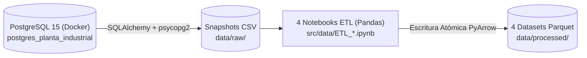

# Mantenimiento Preventivo de Bomba Centrífuga — ETL


-50ABF1?style=flat)

Pipeline **ETL** reproducible (Volumen 1) sobre datos operativos y de mantenimiento de una bomba centrífuga industrial alojados en **PostgreSQL (Docker)**. Organizado bajo la metodología **Cookiecutter Data Science**, extrae cuatro tablas en snapshots CSV, aplica limpieza y normalización modular en notebooks independientes y genera datasets analíticos en formato columnar **Parquet**.

---

## Arquitectura del Flujo




---

## Fuentes de Datos y Resultados

Rango temporal de lecturas operativas: **2026-08-01 a 2026-10-31**.

| Tabla / Fuente | Notebook ETL | Salida Parquet | Dimensiones | Nulos | Duplicados | Transformaciones Clave |
| :--- | :--- | :--- | :---: | :---: | :---: | :--- |
| **catalogo_fallas** | `ETL_catalogo_fallas.ipynb` | `catalogo_fallas_clean.parquet` | 4 × 3 | 0 | 0 | `strip()` en textos y normalización a `snake_case` |
| **equipos** | `ETL_equipos.ipynb` | `equipos_clean.parquet` | 1 × 6 | 0 | 0 | Renombre `ubicación` → `ubicacion`, `snake_case` y tipado de `fecha_instalacion` |
| **lecturas_sensores** | `ETL_lecturas_sensores.ipynb` | `lecturas_sensores_clean.parquet` | 135,130 × 7 | 16,034* | 0 | Eliminación de `col_aux_sistema_v1`, parseo de fechas mixtas (ISO y `DD/MM/YYYY`), limpieza de `temp_carc` (`°C` y coma decimal) |
| **ordenes_mantenimiento** | `ETL_ordenes_mantenimiento.ipynb` | `ordenes_mantenimiento_clean.parquet` | 1 × 7 | 0 | 0 | Limpieza de `tipo_mantenimiento` y tipado de `fecha_inicio` / `fecha_fin` |

*\*Nota de calidad:* En `lecturas_sensores` se conservan 16,034 valores nulos provenientes directamente de los sensores en origen (`temp_carc`, `vibracion_mms`, `pres_desc`, `t_amb`). No se introdujeron nulos por parseo y se evita la imputación automática hasta definir reglas de negocio en el Volumen 2.

---

## Estructura del Proyecto

```text
.
├── data/
│   ├── raw/                                  # Snapshots CSV desde PostgreSQL (no versionados)
│   └── processed/                            # Salidas finales en formato Parquet
│       ├── catalogo_fallas_clean.parquet
│       ├── equipos_clean.parquet
│       ├── lecturas_sensores_clean.parquet
│       └── ordenes_mantenimiento_clean.parquet
├── docs/
│   └── captures/
│       └── 00_arquitectura.png               # Diagrama de arquitectura del pipeline
├── notebooks/                                # Reservado para EDA (Volumen 2)
├── src/
│   ├── data/
│   │   ├── ETL_catalogo_fallas.ipynb
│   │   ├── ETL_equipos.ipynb
│   │   ├── ETL_lecturas_sensores.ipynb
│   │   └── ETL_ordenes_mantenimiento.ipynb
│   └── models/                               # Reservado para modelamiento (Volúmenes 3 y 4)
├── .env.example                              # Plantilla de variables de conexión
├── project_context.md                        # Documentación técnica extendida
├── requirements.txt                          # Dependencias fijadas
└── README.md
```

---

## Requisitos y Configuración

### 1. Instalar dependencias
Requiere **Python 3.11 o superior** (y acceso al contenedor PostgreSQL solo si se desea regenerar los snapshots CSV de `data/raw/`).

```bash
python3 -m venv venv
source venv/bin/activate
pip install -r requirements.txt
```

### 2. Configurar variables de entorno
Copia `.env.example` a `.env` y completa las credenciales de tu instancia PostgreSQL:

```bash
cp .env.example .env
```

```dotenv
DB_HOST=localhost
DB_PORT=5432
DB_NAME=nombre_de_la_base
DB_USER=usuario
DB_PASSWORD=tu_password
DB_SCHEMA=public
DB_TABLE=nombre_de_la_tabla
```

---

## Ejecución

Puedes abrir y ejecutar cada notebook desde Jupyter Lab:

```bash
source venv/bin/activate
jupyter lab
```

O ejecutar los cuatro notebooks secuencialmente desde la terminal:

```bash
for nb in src/data/ETL_*.ipynb; do
  jupyter nbconvert --to notebook --execute --inplace "$nb"
done
```

---

## Próximos Pasos (Roadmap)

* **Volumen 2:** Análisis Exploratorio de Datos (EDA), tratamiento de nulos bajo reglas de negocio, detección de valores atípicos e integración de tablas.
* **Volumen 3:** *Feature Engineering* de variables de operación y degradación de sensores.
* **Volumen 4:** Modelamiento predictivo orientado al mantenimiento preventivo de la bomba centrífuga.